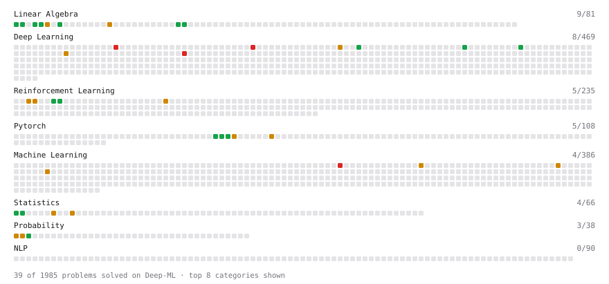

# Deep-ML

My machine learning practice from [Deep-ML](https://www.deep-ml.com). Every solution here was written by hand.

**16** solved · 16 problems · 0 labs · 0 math

[**Browse the interactive portfolio**](https://Jay2310x.github.io/deep-ml/) to replay this filling in over time.

## Problems

| | Difficulty | Solved | |
| --- | --- | --- | --- |
| [Derivative of a Polynomial](https://www.deep-ml.com/problems/116) | easy | 2026-02-09 | [solution](problems/0116-derivative-of-a-polynomial) |
| [Exponential Weighted Average of Rewards](https://www.deep-ml.com/problems/161) | easy | 2026-02-17 | [solution](problems/0161-exponential-weighted-average-of-rewards) |
| [Implement 2D Average Pooling](https://www.deep-ml.com/problems/265) | easy | 2026-02-15 | [solution](problems/0265-implement-2d-average-pooling) |
| [Implement Gradient Clipping by Value](https://www.deep-ml.com/problems/292) | easy | 2026-02-05 | [solution](problems/0292-implement-gradient-clipping-by-value) |
| [Incremental Mean for Online Reward Estimation](https://www.deep-ml.com/problems/159) | easy | 2026-02-20 | [solution](problems/0159-incremental-mean-for-online-reward-estimation) |
| [Matrix-Vector Dot Product](https://www.deep-ml.com/problems/1) | easy | 2026-02-23 | [solution](problems/0001-matrix-vector-dot-product) |
| [Thanksgiving Feast Predictor: Softmax for Dish Selection](https://www.deep-ml.com/problems/216) | easy | 2026-02-11 | [solution](problems/0216-thanksgiving-feast-predictor-softmax-for-dish-selection) |
| [Calculate Correlation Matrix](https://www.deep-ml.com/problems/37) | medium | 2026-02-22 | [solution](problems/0037-calculate-correlation-matrix) |
| [Contrastive Loss (InfoNCE / SimCLR-style)](https://www.deep-ml.com/problems/384) | medium | 2026-02-19 | [solution](problems/0384-contrastive-loss-infonce-simclr-style) |
| [Domain Expert Model Fusion](https://www.deep-ml.com/problems/348) | medium | 2026-02-16 | [solution](problems/0348-domain-expert-model-fusion) |
| [Gridworld Policy Evaluation](https://www.deep-ml.com/problems/142) | medium | 2026-02-12 | [solution](problems/0142-gridworld-policy-evaluation) |
| [Implement Q-Learning Algorithm for MDPs](https://www.deep-ml.com/problems/133) | medium | 2026-02-09 | [solution](problems/0133-implement-q-learning-algorithm-for-mdps) |
| [n-Step TD Prediction](https://www.deep-ml.com/problems/273) | medium | 2026-02-21 | [solution](problems/0273-n-step-td-prediction) |
| [Gaussian Process for Regression](https://www.deep-ml.com/problems/186) | hard | 2026-02-18 | [solution](problems/0186-gaussian-process-for-regression) |
| [Multi-Head Latent Attention (MLA)](https://www.deep-ml.com/problems/405) | hard | 2026-02-23 | [solution](problems/0405-multi-head-latent-attention-mla) |
| [Positional Encoding Calculator](https://www.deep-ml.com/problems/85) | hard | 2026-02-10 | [solution](problems/0085-positional-encoding-calculator) |

---

_This file is regenerated by Deep-ML on every push._
